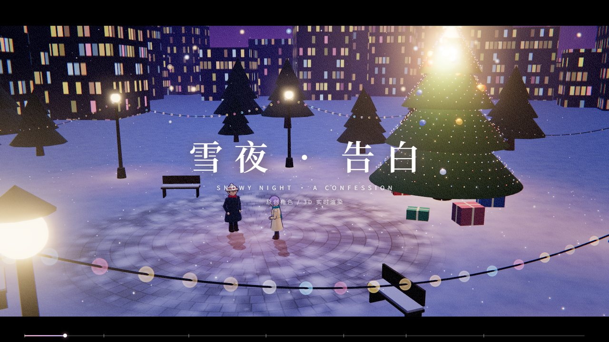
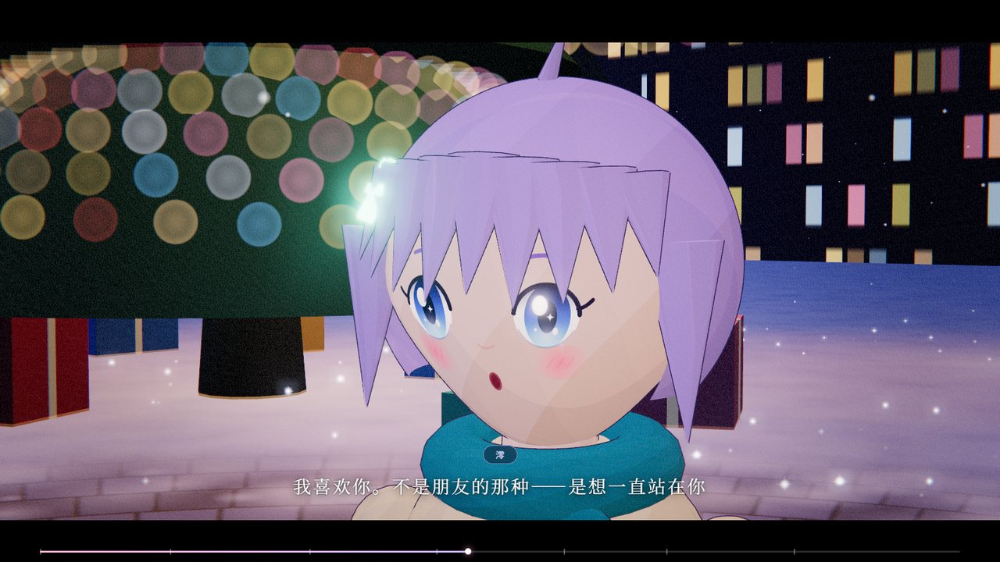
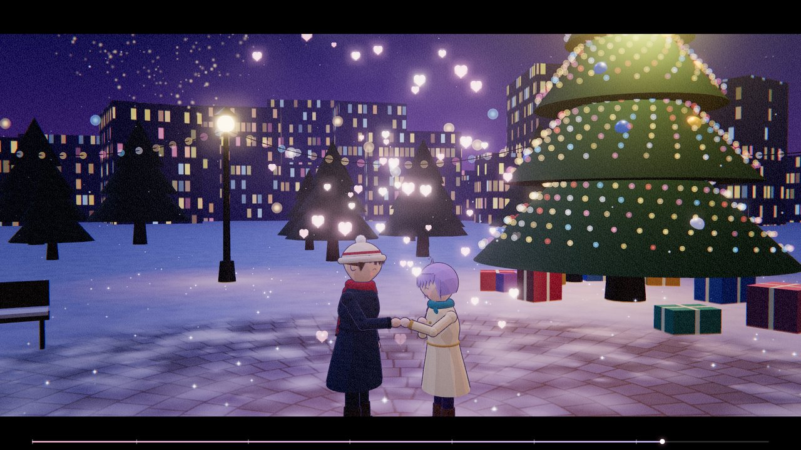
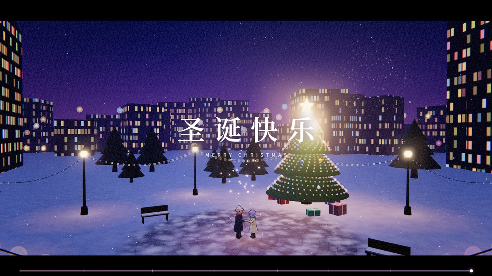

# 雪夜 · 告白(原创 3D 短片)

在浏览器里**实时渲染**的 3D 短片:圣诞夜的雪夜广场,一段原创角色(澪 & 朔)的告白场景。约 58 秒。

**▶ 在线观看:https://vanyangyang.github.io/snowy-night-confession-3d/**






## 观看
- **在线**:打开上面的网址,点「开始」。建议戴耳机、用 Chrome / Edge。
- **本地**:克隆仓库后双击 **`docs/index.html`**(单文件、无需服务器、无需联网)。

| 按键 | 作用 |
|---|---|
| 空格 | 暂停 / 播放 |
| R | 重播 |
| F | 自由视角(拖动旋转、滚轮缩放) |
| ← / → | 快退 / 快进 5 秒 |
| [ / ] | 上一个 / 下一个镜头 |
| M | 静音 |
| P | 截图(PNG) |

底部进度条可点击跳转。

## 分镜(时间线)
开场航拍(0s) → 双人中景(8s) → 女主特写(17s) → 告白慢动作 + 闪白(25s) → 男主反应 + 心跳(33s) → 低机位环绕牵手 + 飘心(39.5s) → 拉升与烟花终场(47.5s)

## 技术
Three.js(卡通着色 + 反壳描边)、程序化角色与 Canvas 实时表情、双骨骼 IK 手臂、景深散景(灯泡按焦距离焦)、泛光/调色/颗粒后期、解析式烟花与爱心(时间的纯函数,可随意拖动进度)、WebAudio 程序化原创配乐与音效。无任何外部素材文件。

## 修改与重新构建
```bash
npm install
npm run build      # 产出 docs/index.html(GitHub Pages 发布用,同时复制一份到 dist/confession-3d.html)
```
改完后提交并推送 `docs/index.html`,Pages 会自动更新。
- `src/director.js` — **改剧情最常用**:`girlKeys / boyKeys`(姿态)、`SHOTS`(镜头)、`LINES`(台词)、表情时间表
- `src/character.js` — 角色造型、发型、服装配色(`SPEC`)、表情绘制
- `src/world.js` — 场景、灯光、天际线;`src/fx.js` — 雪 / 散景 / 爱心 / 烟花
- `src/audio.js` — 配乐(`BARS`)与音效;`src/main.js` — 渲染管线与界面

画面太卡时:页面会自动降低渲染分辨率;也可在地址后加 `?q=low` 关闭抗锯齿并限制像素比。

## 第三方
页面内置 [three.js](https://threejs.org/)(MIT 许可),许可文本见 `THIRD_PARTY_LICENSE_three.js.txt`。
